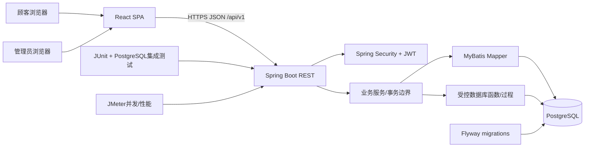
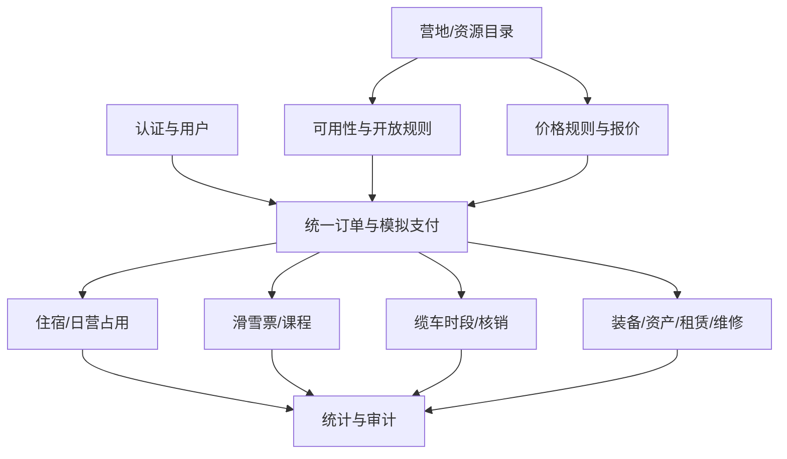
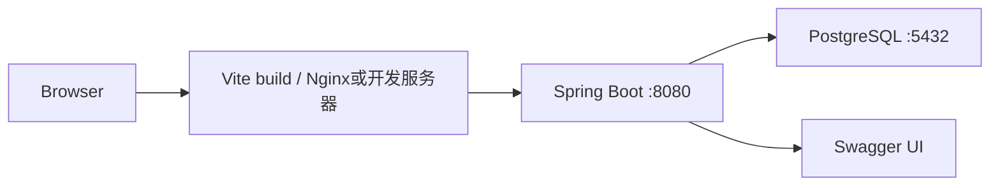

# 系统架构与功能模块

状态：`DRAFT v0.1`。

## 总体架构

## 后端模块

## 分层职责

- Controller：HTTP、DTO、校验、鉴权入口，不写核心SQL。
- Service：用例编排和 `@Transactional` 边界，调用价格/库存/订单组件。
- Mapper：参数化SQL和结果映射，不承载跨模块状态机。
- PostgreSQL：约束、排斥约束、行锁、触发器、视图、统计函数。
- Frontend：呈现和交互，不决定成交金额、库存或权限。

## 关键架构决定

### ADR-001 单体模块化

两人课程设计采用单体 Spring Boot + 单 PostgreSQL。模块通过包和服务边界分离，不使用微服务、Redis或队列。

### ADR-002 统一订单，不使用万能资源外键

`orders/order_items` 提供商业汇总；住宿、票务、课程、缆车和装备各有带真实外键的占用表。避免 `resource_type + resource_id` 无法建立外键，同时避免多个订单体系。

### ADR-003 两类库存

- 单件资源（木屋、营位、具体装备资产）：时间区间排斥约束。
- 容量资源（票、课程、缆车时段、批量装备）：锁定容量/库存行后累计数量。

### ADR-004 价格策略可解释

不照搬复杂实时AI/占用率定价。第一版使用可配置规则和明确优先级；每个价格分量形成快照。

### ADR-005 时间语义

业务时区固定 `Asia/Shanghai`；API时刻带偏移；数据库时刻用 `timestamptz`。住宿和资产使用半开时间范围，按自然日计价时保存 `service_date`。

## 部署视图

课程演示可用 Docker Compose 运行数据库，前后端本机运行；最终可增加全栈 Compose，但不作为第一阶段要求。
