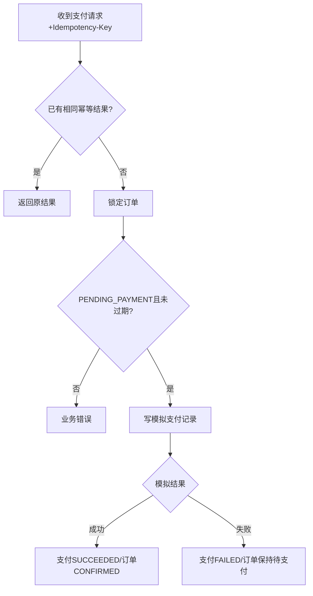
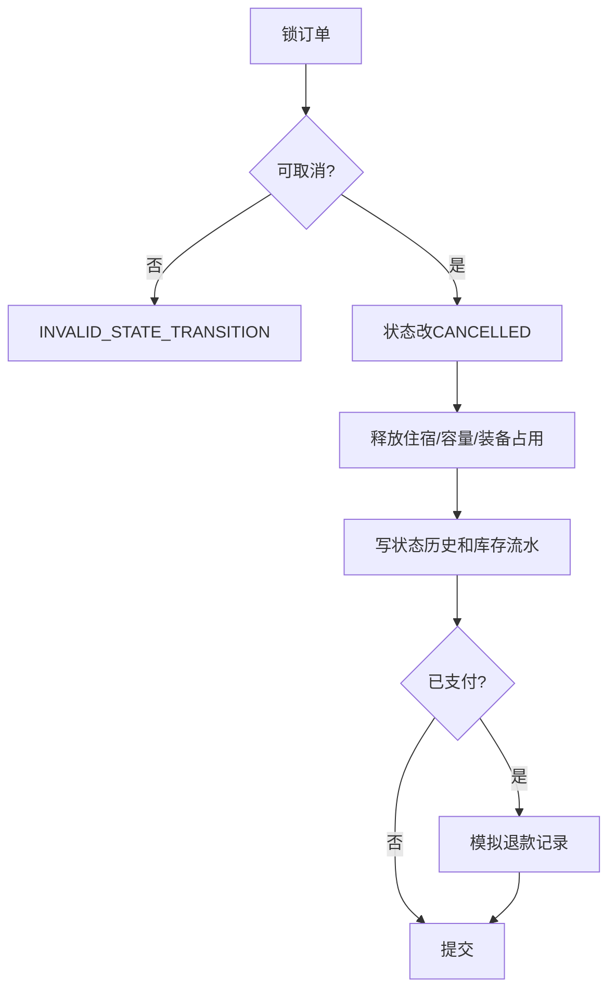
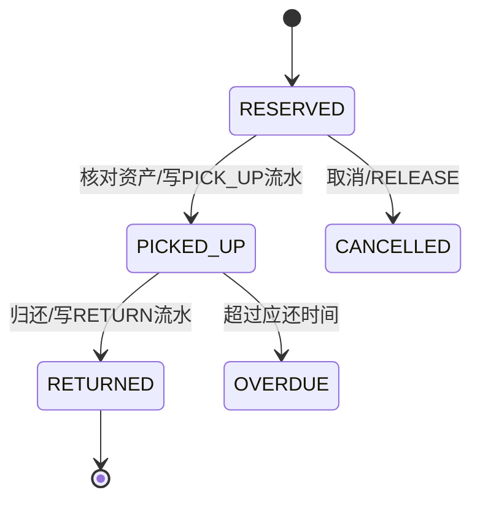

# 主要业务流程

## 1. 住宿/日营预订

```mermaid
sequenceDiagram
    actor C as 顾客
    participant UI as React
    participant API as BookingService
    participant DB as PostgreSQL
    C->>UI: 选择多间住宿、套餐和单选商品
    UI->>API: 查询可用资源/报价
    API->>DB: 开放规则+维修+有效占用+价格规则
    DB-->>API: 可用资源和逐日价格
    API-->>UI: 价格预览+逐项解释
    C->>UI: 确认下单
    UI->>API: POST /orders
    API->>DB: BEGIN; 按固定顺序锁定全部资源; 重算价格
    API->>DB: 插入订单/套餐快照/明细/全部占用
    DB-->>API: 全部成功或任一冲突
    API->>DB: COMMIT
    API-->>UI: 待支付订单/过期时间
```

并发最终防线是住宿/资产排斥约束和容量/库存行锁，不依赖“查询时显示可用”。任一购物车项目失败则整单回滚。

## 2. 模拟支付



## 3. 取消与释放



重复取消读取到终态并返回相同结果，不再次递减容量。

## 4. 票务/缆车容量预约

```text
BEGIN
SELECT session/slot ... FOR UPDATE
校验 OPEN、时间、capacity - reserved_quantity >= request_quantity
插入 order_item 与 ski_booking/lift_booking
reserved_quantity += request_quantity
COMMIT
```

锁的顺序固定为订单→场次/时段（按ID升序），减少死锁。

## 5. 装备取还和维修



归还检查发现损坏时，在归还事务后创建维修记录，资产进入 MAINTENANCE；维修完成后写 `MAINTENANCE_OUT` 并恢复 AVAILABLE。维修区间与租赁区间都参与资产可用性判断。

## 6. 核销

读取二维码/文本码 → 哈希查找令牌 → 锁令牌 → 检查有效期、状态和适用时段 → 写核销事件 → 状态改 USED。唯一约束和行锁保证重复扫描只能一次成功。

## 7. 混合购物车锁顺序

```text
幂等键/用户请求
  → 住宿资源ID升序（排斥约束）
  → 滑雪场次ID升序（FOR UPDATE）
  → 缆车时段ID升序（FOR UPDATE）
  → 批量装备型号ID升序（FOR UPDATE）
  → 单件资产ID升序（排斥约束）
  → 价格与套餐优惠快照
  → 订单提交
```

固定顺序降低混合订单并发死锁风险。v1只允许整单取消；各明细可在不同日期分别履约，但共享一次付款。
