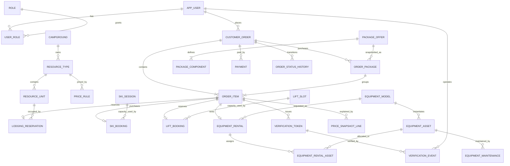

# ER图、关系模式与3NF分析

状态：`CANDIDATE v1.0-rc`，等待另一成员真实 PR Review。为保持图可读，省略审计字段和部分候选实体；完整字段见数据库契约。

## 概念 ER 图

## 关系基数说明

- 用户与角色 M:N，经 `user_role` 分解。
- 营地—资源类型—具体资源均为 1:N。
- 订单与明细 1:N；一个订单可包含多间住宿和多类商品，一种明细至多对应一个同类型业务占用。
- 订单与成交套餐快照 1:N；套餐包含多个订单项，单选项不属于套餐。
- 住宿资源与预订 1:N，但有效时间范围不得重叠。
- 场次/时段与购买记录 1:N，数量和不得超过容量。
- 装备型号与资产 1:N；租赁和具体资产 M:N，经分配表分解。
- 订单项与核销令牌 1:N，令牌与核销事件 1:N；同一令牌至多存在一条成功核销事件，由部分唯一索引保证。

## 关系模式摘要

详细候选模式见 [DATABASE_CONTRACT](../DATABASE_CONTRACT.md)。关键码：

- `APP_USER(user_id)`，候选码 `email`。
- `RESOURCE_UNIT(resource_unit_id)`，候选码 `(resource_type_id, code)`。
- `CUSTOMER_ORDER(order_id)`，候选码 `order_no`、`(user_id, create_idempotency_key)`。
- `ORDER_PACKAGE(order_package_id)`，外码 `order_id/package_offer_id`。
- `ORDER_ITEM(order_item_id)`，外码 `order_id`。
- `LODGING_RESERVATION(reservation_id)`，候选码 `order_item_id`。
- `SKI_SESSION(ski_session_id)`，候选码 `(ski_product_id,start_at)`。
- `LIFT_SLOT(lift_slot_id)`，候选码 `(lift_id,start_at)`。
- `EQUIPMENT_ASSET(asset_id)`，候选码 `asset_code`。
- `PAYMENT(payment_id)`，候选码 `payment_no`、`(order_id, idempotency_key)`。
- `VERIFICATION_TOKEN(token_id)`，候选码 `token_hash`，外码 `order_item_id`。
- `VERIFICATION_EVENT(event_id)`，候选码 `(operator_id, idempotency_key)`，外码 `token_id`、`operator_id`；`result='ACCEPTED'` 时 `token_id` 全局唯一（部分唯一索引）。

## 3NF验证

1. 所有关系属性原子化；多星期、多角色、多资产使用关联表，不保存逗号列表。
2. 复合码关系（如 `user_role`、`price_rule_weekday`）的非键属性若存在，依赖整个复合码。
3. 资源类型属性不重复存入具体资源，角色名称不存入用户，装备型号属性不存入每条租赁，消除传递依赖。
4. 订单商业信息与业务占用分离；所有占用通过 `order_item_id` 回溯同一订单，不建立重复订单主表。
5. 价格快照、套餐快照、订单项目名称快照和容量计数是有理由的历史/性能冗余：分别保证历史不可变和并发更新效率。它们必须由事务维护，并在报告中说明。

## 一致性检查结论

- 用户体系：唯一 `app_user/user_role`。
- 订单体系：唯一 `customer_order/order_item`，各业务只有占用扩展表。
- 库存体系：统一不可变 `inventory_movement`，住宿/容量/装备采用适合各自语义的占用结构。
- 状态枚举：来自单一 `ENUMS.md`。
- 字段/DTO：API使用 camelCase、数据库使用 snake_case，由Mapper明确映射。
- 事务：创建和取消跨订单、占用、支付/流水必须单事务。
